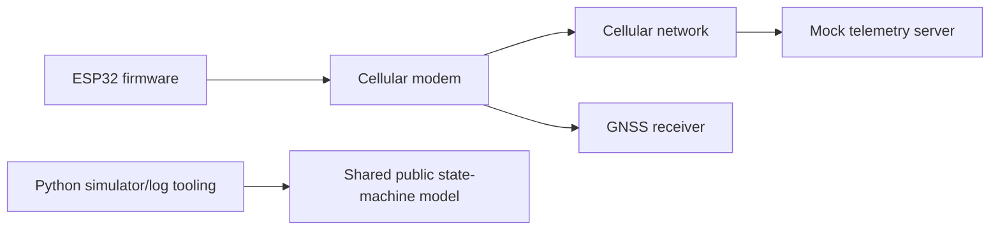
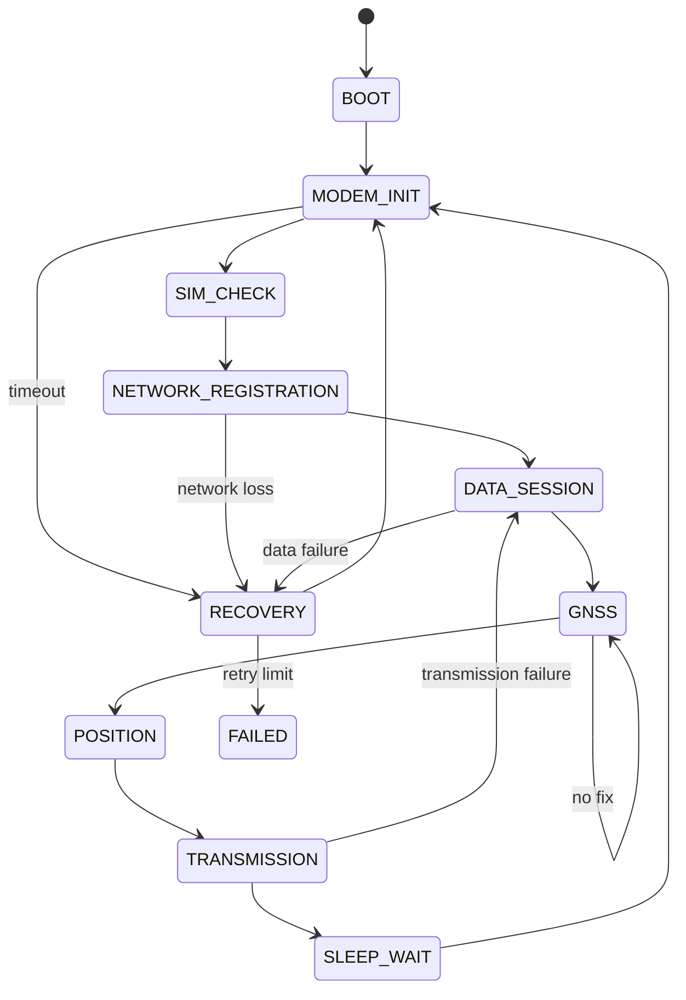

# Cellular GNSS Tracker Lab

ESP32 cellular/GNSS engineering lab with a public state machine, modem AT-command concepts, resilience behavior, synthetic logs and Python tooling.

## Why

Cellular trackers fail in messy ways: modem timeouts, SIM problems, network registration loss, data session drops, GNSS no-fix periods and transmission failures. This project is not a GPS tutorial. It is a small public lab for reasoning about those failure modes with deterministic simulation and no corporate firmware, APNs, endpoints or device identifiers.

## Features

- ESP32-style firmware skeleton with clear tracker states.
- Generic AT-command parsing and timeout/error handling.
- State machine: boot, modem init, SIM check, network registration, data session, GNSS, position, transmission, sleep/wait and recovery.
- Retry counters, modem reset modeling, watchdog kicks and exponential backoff helper.
- Synthetic scenarios: normal operation, network failure, GNSS no fix, modem timeout, transmission failure and recovery.
- Python CLI for simulation and JSONL log analysis.
- CI-friendly software validation without hardware.

## Architecture



## State Machine



## Tech Stack

- Python 3.11+
- PyTest
- coverage.py
- Ruff
- Arduino-style ESP32 C++ firmware skeleton
- GitHub Actions
- CodeQL and dependency review

## Quick Start

```bash
python -m pip install -e ".[dev]"
cellular-gnss-lab list-scenarios
cellular-gnss-lab simulate --scenario recovery --log reports/recovery.jsonl
cellular-gnss-lab analyze-log reports/recovery.jsonl
```

## Demo / Simulation

Simulation is mandatory and is the validated public demo path:

```bash
cellular-gnss-lab simulate --scenario normal_operation
cellular-gnss-lab simulate --scenario network_failure
cellular-gnss-lab simulate --scenario gnss_no_fix
```

All telemetry positions, APNs and hostnames are synthetic examples.

## Tests

```bash
python -m ruff check .
python -m pytest --cov --cov-report=term-missing -q
```

The tests cover state transitions, retry limits, GNSS no-fix behavior, transmission recovery, AT response parsing and log analysis.

## Project Structure

```text
firmware/
  include/config.example.h
  src/main.cpp
src/cellular_gnss_tracker_lab/
  at_commands.py
  cli.py
  logs.py
  state_machine.py
tests/
docs/
examples/
```

## Engineering Decisions

- Firmware and Python tooling are separated so CI can validate behavior without embedded hardware.
- AT commands are modeled generically and only with public concepts.
- Hardware validation is not claimed until a real ESP32/modem/GNSS bench is used.

## Security

This repository uses synthetic data only. Do not commit real APNs, servers, device identifiers, IMEI, ICCID, customer positions, private logs, credentials or corporate firmware.

## Limitations

- Simulation/software validation completed; hardware validation pending.
- Firmware is a public skeleton and is not compiled in CI because the embedded toolchain is not required in this environment.
- Network and GNSS behavior is modeled, not physically measured.

## Roadmap

- Add optional PlatformIO validation once the toolchain is available.
- Add mock telemetry server examples.
- Add richer modem response fixtures from public documentation.

