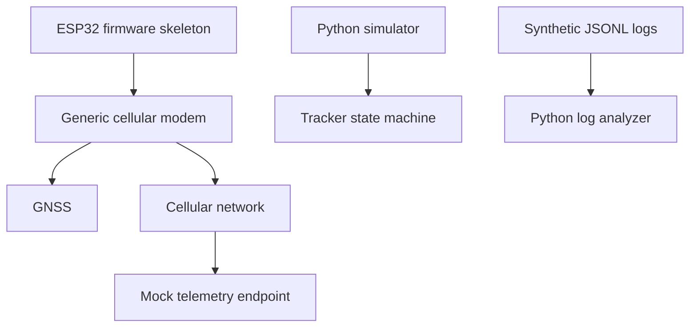

# Architecture

The Python model mirrors the public state-machine concepts used by the firmware skeleton. It provides deterministic validation for retries, recovery and failure classification while hardware validation remains pending.

