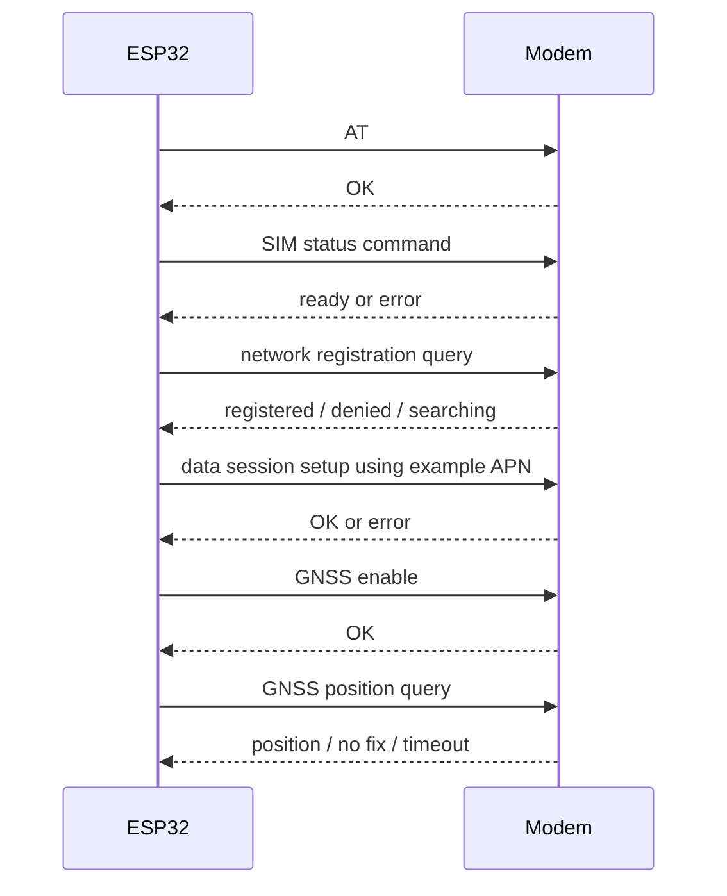

# Fluxo de Comandos AT / AT Command Flow

Este fluxo e generico e baseado em conceitos publicos. Ajustes reais dependem do modem e do datasheet publico do fabricante.

## Fluxo seguro de alto nivel

## Estados e respostas

| Estado | Resposta esperada | Falha tratada |
| --- | --- | --- |
| `MODEM_INIT` | `OK` | timeout |
| `SIM_CHECK` | SIM pronto | SIM ausente |
| `NETWORK_REGISTRATION` | registrado | negado, procurando, perda de rede |
| `DATA_SESSION` | sessao ativa | falha de attach/session |
| `GNSS` | GNSS habilitado | timeout |
| `POSITION` | latitude/longitude/status | sem fix, coordenada malformada |
| `TRANSMISSION` | envio simulado OK | falha de transmissao |

## Boas praticas

- Definir timeout por comando.
- Registrar estado, evento e proximo estado.
- Limitar retries.
- Resetar modem apenas quando fizer sentido.
- Nunca salvar IMEI/ICCID em log publico.
- Separar configuracao privada de exemplos publicos.

## English Summary

Use only public, generic AT command concepts. Real modem command names may vary by vendor and must be taken from public datasheets, not private firmware or company documentation.

