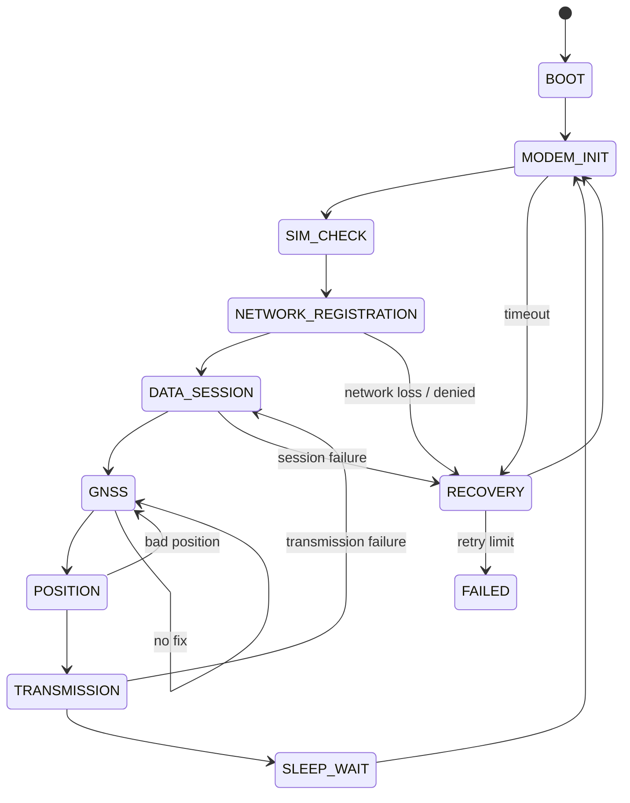

# Maquina de Estados / State Machine

## Diagrama

## Validado por software

- Transicao normal ate `SLEEP_WAIT`.
- Timeout de modem.
- Perda de rede.
- GNSS sem fix.
- Falha de transmissao.
- Limite de recuperacao.
- Logs sinteticos JSONL.

## Ainda nao validado em hardware

- Comportamento real de modem.
- Tempo real de registro.
- Tempo real de fix GNSS.
- Consumo em sleep/wait.
- Recuperacao apos perda fisica de sinal.

## English Summary

The state machine is validated through deterministic Python tests and synthetic logs. Real modem/GNSS timing remains hardware-validation work.

